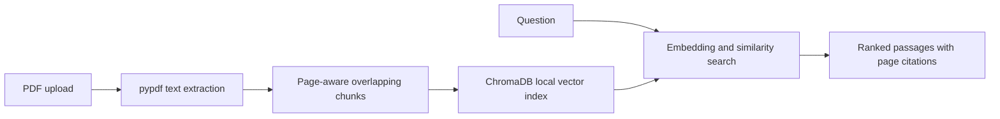

# PDF RAG Assistant

A small, local-first PDF question search app built with Python, Streamlit, pypdf, and ChromaDB.

## What it does

- Extracts selectable text from an uploaded PDF.
- Splits each page into overlapping chunks and keeps page metadata.
- Uses ChromaDB's default embedding function for semantic vector search.
- Displays the highest ranked source passages with page citations.
- Keeps the vector database on the local machine in `chroma_db/`.

This is the **retrieval baseline**. It returns evidence passages rather than a model-written answer. A local language model can be added later when model downloads are available and the computer has enough memory.

## Architecture



## Requirements

- Windows, macOS, or Linux
- Python 3.12
- Internet access the first time Chroma downloads its default embedding model

## Run locally on Windows

Open PowerShell in the project folder and run:

```powershell
python -m venv .venv
.\.venv\Scripts\Activate.ps1
python -m pip install -r requirements.txt
python -m streamlit run app.py
```

Upload a text-based PDF, enter a question, and inspect the returned passages and page numbers. Scanned PDFs need OCR before this app can search their contents.

## Evaluation

The starter evaluation set is in `eval/questions.json`. It records questions and relevant page numbers for the ISDN course PDF. Keep that PDF on your computer; it is intentionally excluded from Git.

Run the page-level retrieval evaluation with:

```powershell
python -m eval.evaluate "C:\path\to\ISDNn.pdf"
```

The script reports **Recall@k**: the fraction of evaluation questions for which at least one expected page appears in the top-k retrieved passages. Change `k` in `eval/questions.json` or pass `--k`, for example:

```powershell
python -m eval.evaluate "C:\path\to\ISDNn.pdf" --k 5
```

### Initial baseline

On the 8-page ISDN course PDF (19 chunks, 6 questions), this setup produced:

| Metric | Result |
| --- | ---: |
| Page Recall@3 | 5/6 (83.3%) |
| Page Recall@5 | 6/6 (100.0%) |

Increasing `k` found the expected page for the missed Frame Relay advantages question, while also returning more unrelated passages. This is a small, document-specific development set; it is not a general quality guarantee.

Use this baseline to compare chunk sizes, overlap, and retrieval settings. Record each change and its Recall@k in your project notes before selecting a configuration.

## Privacy and limitations

- Uploaded PDF text and embeddings are stored locally in `chroma_db/`.
- Do not commit private PDFs, `.env`, `.venv/`, or `chroma_db/`.
- The current version searches text PDFs; it does not OCR scanned pages or generate natural-language answers.
- The ISDN evaluation set is a small development benchmark, not a general-purpose quality guarantee.

## Next improvements

1. Add OCR for scanned PDFs.
2. Compare chunk sizes and overlap with the evaluation set.
3. Add hybrid keyword and vector retrieval.
4. Add a reranker and evaluate Recall@k / MRR.
5. Add local or hosted answer generation when hardware or API access permits.
