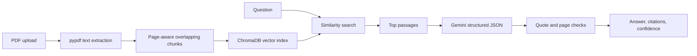

# PDF RAG Assistant

Ask a question about an uploaded PDF and get an answer written only from that document, with page citations.

## Live demo

[Open PDF RAG Assistant](https://pdf-rag-assistant1-fsygsdfxayn3ifpgvyqggb.streamlit.app/)

The hosted app needs a Gemini API key configured in Streamlit secrets (`GEMINI_API_KEY`). Locally, use a `.env` file as described below.

## What it does

- Extracts selectable text from an uploaded PDF with pypdf.
- Splits each page into overlapping chunks and keeps the page number on every chunk.
- Stores those chunks in a local ChromaDB index and searches them by meaning.
- Sends the top passages to Gemini, which writes an answer **only from that text**.
- Asks Gemini for structured JSON: the answer, short quotes, page numbers, a confidence score, and whether the answer was actually in the document.
- Drops citations whose page was not retrieved, or whose quote does not appear in the retrieved text.
- Shows the answer, the citations, and the passages that were sent to the model.
- If the question is not in the PDF, says so instead of guessing.

Scanned PDFs (image-only pages) have no selectable text, so the app stops and asks for OCR first. Each question is answered on its own; there is no chat history.

## Architecture



## Setup

Python 3.10 or newer.

```bash
python -m venv .venv
```

Windows:

```bash
.venv\Scripts\activate
pip install -r requirements.txt
copy .env.example .env
```

macOS and Linux:

```bash
source .venv/bin/activate
pip install -r requirements.txt
cp .env.example .env
```

Open `.env` and set `GEMINI_API_KEY` to your own key. `GEMINI_MODEL` is optional; it defaults to `gemini-3.1-flash-lite`.

```bash
streamlit run app.py
```

The local vector index is stored in `chroma_db/`. That folder is gitignored.

## Project layout

| Path | Role |
|---|---|
| `app.py` | Streamlit UI: upload, search, answer, citations |
| `src/pdf_rag.py` | Extract, chunk, index, retrieve |
| `src/llm.py` | Prompt, Gemini call, citation cleanup |
| `src/schemas.py` | `RAGAnswer` JSON shape |
| `prompts/rag_prompt_v1.txt` | Instructions and examples for the model |
| `test_llm.py` | One in-document question and one refusal |
| `eval/` | Retrieval recall and full-answer scoring |

## Checks

Retrieval only (no Gemini call). Pass the PDF that matches `eval/questions.json`:

```bash
python eval/evaluate.py path\to\your.pdf
```

Full answers (uses the API key). Put `ISDNn.pdf` in `eval/` first. PDFs are gitignored, so that file is not in the repo.

```bash
python eval/run_eval.py
```

Smoke test for Gemini structured output:

```bash
python test_llm.py
```
